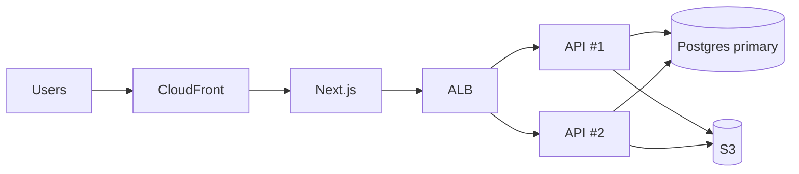

# System Design

## Purpose

Produce architectures that fit **today's** requirements with a clear, incremental path to tomorrow's — and explain every trade-off. Complexity must be earned by a requirement or a measurement.

## Rules

### R1. Start from requirements and numbers
Before proposing architecture, state:
- **Functional** requirements (core use cases).
- **Non-functional**: expected users/tenants, requests per second (avg/peak), data size and growth, read/write ratio, latency targets, availability target (99.9% ≈ 43 min/month downtime), consistency needs, compliance/data residency, team size & skills, budget.
- Back-of-envelope estimate. Example: 2,000 schools × 500 students × 5 requests/day ≈ 5M req/day ≈ ~60 req/s avg, ~300 peak → **one well-indexed Postgres + 2 API instances is plenty**.
If numbers are unknown, state assumptions explicitly.

### R2. Default architecture
A **modular monolith** (clear domain modules, no cross-module DB access) + one primary database + object storage + CDN for static assets, deployed as ≥ 2 stateless instances behind a load balancer for availability. Add components only via R3.

### R3. Add a component only when its trigger is present
| Component | Trigger (evidence) | Cost |
|---|---|---|
| Horizontal scaling (more instances) | CPU/memory saturation, availability needs | Requires stateless app (sessions in DB/Redis, files in S3) |
| Vertical scaling | Single bottleneck (DB) — often cheapest first step | Has ceilings; downtime on some resizes |
| CDN | Static assets, public pages, global users | Cache invalidation |
| App/data cache (Redis) | Hot reads with measured DB load/latency, shared across instances; rate limiting; sessions | Invalidation, consistency, another service to run |
| Read replicas | Read-heavy load saturating primary after indexing/caching; reporting queries hurting OLTP | Replication lag → read-your-writes issues |
| Partitioning (Postgres) | Very large time-series/log tables (100M+ rows), retention by time | Query/index complexity |
| Sharding | Write volume/data size beyond a single primary even after vertical scaling | High complexity; cross-shard queries; do last |
| Queue + workers | Slow/unreliable work off request path; spikes; retries | Eventual consistency, idempotency, monitoring |
| Event-driven / pub-sub (in-process → SNS/SQS/EventBridge → Kafka) | Multiple independent consumers of the same event; decoupled integrations; audit/event streams | Debuggability, ordering, schema evolution |
| Kafka specifically | High-throughput streaming, replay, ordered partitions, many consumers | Significant ops cost; SQS/SNS usually enough below that scale |
| Search engine (Elasticsearch/OpenSearch/Atlas Search) | Full-text relevance/facets beyond DB capabilities at scale | Sync pipeline, extra cluster |
| Microservices | See R4 | Distributed-systems tax |

### R4. Microservices decision
Consider extracting a service only when at least one **concrete** reason exists:
- Independent deployment cadence needed by separate teams owning the code.
- Significantly different scaling or resource profile (e.g., video transcoding, ML inference, websocket gateway).
- Fault isolation for a risky/unstable component.
- Different tech/runtime requirement.
- Strong regulatory/security boundary (payments/PCI scope).
Extraction path: well-bounded module in the monolith → module's own schema/tables → communicate via its service interface/events → extract to a service with its own DB. Never share a database between services. Expect: network failures, distributed transactions (sagas/outbox), tracing, versioned contracts, more deployments.

### R5. Statelessness for horizontal scale
App instances keep no local state that matters: sessions in cookie/DB/Redis, uploads to S3, scheduled jobs guarded to run once (leader lock or a dedicated worker), in-memory caches treated as per-instance and disposable.

### R6. Failure handling
- Timeouts on every outbound call (DB, HTTP, Redis).
- Retries only for idempotent operations, with exponential backoff + jitter, capped.
- Idempotency keys for operations that may be retried (payments, webhooks, job handlers).
- Circuit breaker / fallback for flaky third parties where degradation is acceptable.
- Outbox pattern when a DB write and a message publish must both happen reliably.
- Dead-letter queues for poison messages; alert on DLQ growth.
- Graceful degradation: show cached/partial data rather than failing the whole page when a non-critical dependency fails.

### R7. Rate limiting & backpressure
Protect the system per IP/user/tenant at the edge (API gateway/WAF/ALB) or app (Redis-backed when multi-instance). Bound queue consumers' concurrency; bound request sizes and page sizes.

### R8. Data & storage
- OLTP DB for transactional data; object storage (S3) for files/blobs; never store large files in the DB.
- Reporting/analytics heavy queries → read replica, pre-aggregated tables, or a warehouse when needed.
- Backups + point-in-time recovery + tested restore for production DBs.

### R9. Observability is part of the design
Logs (structured, correlated), metrics (RED: rate, errors, duration; USE for resources), traces (OpenTelemetry) once more than one service/worker is involved. Define SLOs for critical paths.

### R10. Present designs with trade-offs
Every proposal includes: the requirement it serves, chosen option, alternatives considered, costs (complexity, ops, money), risks, and the **next step** when load grows (what metric triggers it).

## Implementation Guidelines (design answer template)

1. **Requirements & assumptions** (functional, NFRs, numbers).
2. **Estimates** (RPS, storage, bandwidth).
3. **Current-stage architecture** (diagram in text/mermaid): components and why.
4. **Data model & key APIs** (high level).
5. **Bottlenecks & failure modes** and how they're handled.
6. **Trade-offs** (chosen vs alternatives).
7. **Evolution path**: Stage 1 → 2 → 3 with metric triggers.

## Examples

**Evolution path for a school-management SaaS**
```
Stage 1 (now, < 200 req/s):
  Next.js (Vercel or container) → NestJS modular monolith (2 instances, ALB)
  → Postgres (RDS, Multi-AZ) ; S3 for documents ; SES for email ; cron for daily jobs
Stage 2 (trigger: p95 > 500 ms on reads after indexing, or report queries slowing OLTP):
  + read replica for reports ; + Redis for hot lookups & rate limiting ; + BullMQ/SQS workers for PDFs/imports
Stage 3 (trigger: separate team for billing or notification volume spikes harming API):
  extract Notifications service (owns its DB, consumes events via SQS/SNS) ; outbox in monolith
Stage 4 (trigger: large tenants dominating load / residency requirements):
  dedicated DB for enterprise tenants ; partition attendance table by month
```

**Mermaid sketch**


## Anti-patterns

- Microservices for a new product with one team "for scalability".
- Kafka for a few hundred events per minute.
- Redis cache added before indexes/projections.
- Read replicas used for read-after-write flows (users don't see their own updates).
- Sharing one database between "microservices".
- Retrying non-idempotent operations blindly.
- Architecture diagrams without numbers or trade-offs.
- Designing for 100M users when the requirement is 10k.

## Checklist

- [ ] Requirements, numbers and assumptions stated.
- [ ] Default (modular monolith + one DB) used unless a trigger justifies more.
- [ ] Each added component mapped to a concrete trigger and its cost.
- [ ] App stateless for horizontal scaling.
- [ ] Timeouts, safe retries, idempotency, DLQ/outbox where messaging is used.
- [ ] Rate limiting/backpressure considered.
- [ ] Backups/PITR, observability included.
- [ ] Trade-offs and evolution path with metric triggers documented.
